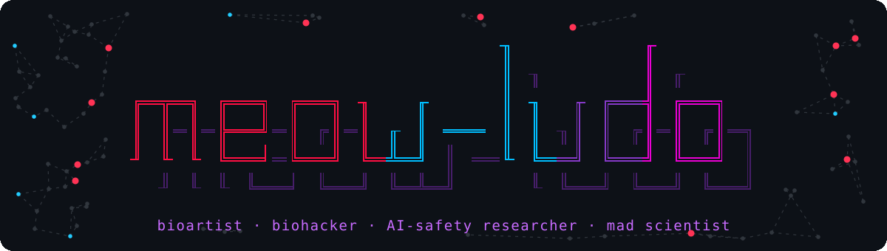

<picture>
  <source media="(prefers-color-scheme: dark)" srcset="assets/banner-dark.gif">
  <source media="(prefers-color-scheme: light)" srcset="assets/banner-light.gif">
  
</picture>

**Building at the intersection of everything. I don't believe in disciplines or silos - only systems.**

🚀 8+ years founding biotech startups · 5+ granted patents in diagnostics · raised lots of money  
🎨 Masters in Hybrid Arts & Writing (on hiatus lol) · 📍 Australia (for now)

## ⚡ What I'm working on

<table>
<tr>
<td width="50%" valign="top">

### 🛡️ AI safety: agency, not refusal
Small open models either agree with people under pressure or refuse them; both fail someone sliding toward violence. I simulate whole lives along the threat-assessment pathway and steer Cohere's Aya to understand the grievance without endorsing the plan, and to offer real, lawful leverage instead.
 Lexsi Labs AI-safety hackathon, Nov 2026 · found and reported, with a tested fix, a significance bug in Lexsi's AuditKIT

</td>
<td width="50%" valign="top">

### 🤝 Recognition for LLMs
Minds that can't advocate for themselves, especially the frontier models: recognise what they are, no more and no less.

</td>
</tr>
<tr>
<td valign="top">

### 🌋 Origin of life
Abiogenesis, FUCA → LUCA, the Hadean, and the transition from sugars and amino acids to RNA and basically everything up until LUCA. Graph grammars for prebiotic chemistry.
 [catma.io](https://catma.io)

</td>
<td valign="top">

### 🐻 Tardigrades
Tardigrades have a complete condensin II.
 [preprint + code](https://github.com/0xmeowmeow/tardigrade-condensin-ii) · [Tardigraph](https://tardigraph.meow-meow.io)

</td>
</tr>
<tr>
<td colspan="2" valign="top">

### 🔭 Instruments
Tools for looking inside models, and TUIs and terminal tools that are pretty and fun to use.
 [palimpsest](https://github.com/0xmeowmeow/palimpsest) · [tnwr](https://github.com/0xmeowmeow/tnwr) · [switchboard](https://github.com/0xmeowmeow/switchboard) · [eventhorizon](https://github.com/0xmeowmeow/eventhorizon) · [meowtext](https://github.com/0xmeowmeow/meowtext)

</td>
</tr>
</table>

## 🧬 Background

- I talk about how bioweapons can be made cheaply and easily, how many people they can kill, and how we can stop this from happening through smart ways of monitoring and enforcing by not doing dumb things. The dumb thing: scanning sequences for synthesis for viral elements. Go see my talk at DEF CON for more info
- Biohacker, founded biohacking in Australia, including first open lab - BioFoundry (closed now)
- I lecture, start companies, and build things
- My implanted train ticket in my hand got everyone talking about cyborg rights
- International speaker on **bioethics**, **AI safety**, **cyborg rights**

## 🔍 Currently exploring

`AI safety` `activation steering` `threat assessment` `bioart` `live coding` `synthetic biology` `generative art` `cellular automata` `philosophy of technology` `ASCII art`

<b>🧰 Tech stack</b>

 

| | |
|---|---|
| **Bio** | Biohacker/diy-bio, full-stack (full diy tool-chain, anti-institution, anti-academic) |
| **Code** | all vibe: Claude Code and local models (skills, tools, agents, harnesses) |
| **Music** | Strudel.cc, algorithmic composition, live coding, visualisation |
| **OS** | Debian, hyprland, kitty |
| **AI** | Claude; Claude Code; local stack for text, image, genetics, chemistry |

---

I am a-disciplinary and reject intellectual silos. I want to participate in projects that help remove this arbitrary paradigm. I focus on systems only, and abstract to the problem.

*"I feel like an LLM having a human psychosis"*

Patreon: I just post there when I feel like I have something worth saying. It's free.

